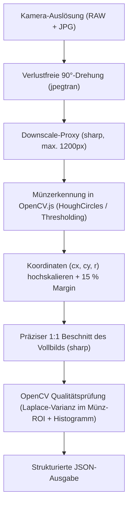

# Architektur- & Implementierungsansatz: Coin-Capture Pipeline

Dokumentation des technischen Ansatzes, der Modulstruktur und des Implementierungsplans für die automatisierte Münzfotografie- und Katalogisierungs-Pipeline gemäß [task.md](file:///Users/luke/Projects/claude/toss-a-coin-to-an-agent/task.md).

---

## 1. Technologie-Stack & Kernentscheidungen

### 1.1 Reines TypeScript ohne Build-Schritt (No Compilation Step)

- **Runtime:** Node.js v26 mit nativem Type-Stripping (`--experimental-strip-types` / standardmäßig aktiv).
- **TypeScript:** Ausschließlich für Typprüfung (`npm run typecheck` via `tsc --noEmit`).
- **Restriktionen:** Verwendung von `erasableSyntaxOnly: true` (keine `enum`, `namespace` oder Constructor Parameter Properties), damit Node `.ts`-Dateien direkt ohne Transpiler/Bundler ausführen kann.

### 1.2 Vollständiger Verzicht auf Python

Alle Anforderungen aus Stufe 1 werden in reinem TypeScript realisiert:

- **Kamerasteuerung & USB:** `gphoto2` CLI via `node:child_process`.
- **Verlustfreie Rotation (JPG):** `jpegtran` (lossless DCT-Transformation).
- **RAW-Orientierung:** `exiftool` (Setzen des EXIF-Orientation-Tags im `.CR2`).
- **Bildverarbeitung & OpenCV:** `@techstark/opencv-js` (WebAssembly) in Kombination mit `sharp` (libvips).

---

## 2. Bildverarbeitungs-Strategie (Hybrid: Sharp + OpenCV.js)

Eine Canon EOS 1300D liefert 18 Megapixel (5184 × 3456 Pixel). Die Dekodierung eines unkomprimierten 18MP-Bildes in ein WASM-Matrix-Objekt belegt ~72 MB linearen C++-Heap-Speicher pro `cv.Mat`.

Um maximale Geschwindigkeit bei minimalem Speicherverbrauch zu garantieren, setzen wir auf ein **hybrides 3-Schritt-Verfahren**:



1. **Schnelle Erkennung auf Downscale-Proxy:**
   `sharp` erzeugt in ~20 ms eine verkleinerte Arbeitskopie (z. B. max. 1200 px). Auf dieser Kopie führt OpenCV.js `cv.HoughCircles` bzw. Kontur-Thresholding in <10 ms aus, um Mittelpunkt `(cx, cy)` und Radius `r` der Münze zu ermitteln.
2. **Skalierung & 1:1 Beschnitt:**
   Die Koordinaten werden mit dem Downscale-Faktor auf das 18MP-Original hochgerechnet. Unter Hinzurechnung des konfigurierbaren Randabstands (Default: **15 % Margin**) schneidet `sharp` den quadratischen Bereich verlustarm aus dem gedrehten Original-JPG aus.
3. **Deterministische Qualitätsprüfung im ROI:**
   - **Schärfe:** Das ausgeschnittene Bild wird analysiert. Über eine zirkuläre Maske (exakt auf Münzradius beschränkt) wird der weiße Hintergrund maskiert. Anschließend wird die Varianz des Laplace-Operators (`cv.Laplacian` + `cv.meanStdDev`, Varianz = $\sigma^2$) berechnet.
   - **Belichtung:** Über `cv.calcHist` wird das Helligkeitshistogramm auf Highlight-Clipping (Überbelichtung / ausgefressene Reflexionen) und Unterbelichtung (zu geringe mittlere Helligkeit) geprüft.
4. **WASM-Speichersicherheit:**
   Da WebAssembly-Speicher nicht automatisch vom Node.js Garbage Collector bereinigt wird, werden alle `cv.Mat`-Instanzen über Scoped-Helper mit `try ... finally { mat.delete(); }` abgesichert.

---

## 3. Ziel-Verzeichnisstruktur

```text
toss-a-coin-to-an-agent/
├── kb/                                # Lokale Knowledge Base
│   ├── index.json                     # Zentraler Münzindex & Status
│   ├── assets/                        # Beschnittene, finale JPGs (COIN-0001_peace-dollar_av.jpg)
│   ├── archive/                       # Original-RAWs (.CR2) & unbeschnittene Aufnahmen
│   └── coins/                         # Markdown-Akten mit YAML-Frontmatter (COIN-0001.md)
│
├── src/
│   ├── camera/
│   │   ├── ptp.ts                     # USB-Handling & Beenden von ptpcamerad / EOS Utility
│   │   ├── config.ts                  # Baseline-Parameter (Av, F8.0, ISO 100, Custom WB, EV)
│   │   └── capture.ts                 # gphoto2 Auslöse- & Download-Steuerung
│   │
│   ├── image/
│   │   ├── rotate.ts                  # Verlustfreie 90°-Drehung (jpegtran & exiftool)
│   │   ├── detect.ts                  # Münzerkennung (Zentrum, Radius, Bounding-Box)
│   │   ├── crop.ts                    # 1:1 Zuschnitt mit konfigurierbarem Margin
│   │   └── quality.ts                 # Schärfemessung (Laplace-Varianz) & Belichtungs-Check
│   │
│   ├── kb/
│   │   ├── store.ts                   # ID-Generierung (COIN-xxxx) & index.json Verwaltung
│   │   └── markdown.ts                # Erstellung & Update von kb/coins/COIN-xxxx.md
│   │
│   ├── types/
│   │   └── index.ts                   # Zentrale Interfaces (CaptureResult, CoinEntry, etc.)
│   │
│   └── cli/
│       ├── capture.ts                 # Stufe 1: Standalone Capture & Check CLI
│       └── ingest.ts                  # Stufe 2: Interaktiver Erfassungs-Loop
│
├── scripts/
│   └── doctor.ts                      # Umgebungs- und Toolchain-Validierung
│
├── APPROACH.md                        # Dieses Dokument
├── task.md                            # Ursprüngliche Aufgabenspezifikation
├── package.json
└── tsconfig.json
```

---

## 4. Schnittstellendefinition (Stufe 1 JSON-Return)

Das Capture- & Qualitätsprüfungs-Modul liefert bei jedem Aufruf ein deterministisches JSON-Ergebnis:

```typescript
export type QualityStatus = "ok" | "blurry" | "underexposed" | "overexposed";

export interface CaptureResult {
  status: QualityStatus;
  sharpness_score: number; // Varianz des Laplace-Operators auf Münz-ROI
  mean_brightness: number; // Mittlere Helligkeit (0-255)
  clipping_ratio: number; // Anteil gesättigter Pixel (Lichter)
  coin_detected: boolean; // Ob Münzkontur sicher gefunden wurde
  coin_center: { x: number; y: number };
  coin_radius: number;
  cropped_jpg_path: string; // Pfad zum 1:1 beschnittenen JPG
  raw_path: string; // Pfad zum archivierten .CR2
  warnings: string[];
}
```

---

## 5. Schrittweiser Implementierungsplan

### Phase 1: Vorbereitung & Typen (Stufe 1 Basis)

1. **Ordnerstruktur & Typen:** Anlegen von `src/types/index.ts` mit allen Datenstrukturen für Kameraeinstellungen, Bildanalyse und KB-Einträge.
2. **Kamera- & USB-Steuerung (`src/camera/`):**
   - `ptp.ts`: Beenden störender macOS-Prozesse (`killall ptpcamerad`).
   - `config.ts`: Baseline-Parameter für Canon EOS 1300D (`aperture=8`, `iso=100`, `imageformat=RAW + Large Fine JPEG`, etc.).
   - `capture.ts`: Auslösung via `gphoto2 --capture-image-and-download` in ein temporäres Verzeichnis.

### Phase 2: Bildverarbeitung & Qualitätsprüfung (`src/image/`)

1. **Rotation (`rotate.ts`):** 90°-Drehung des JPGs via `jpegtran -rotate 90` sowie Setzen des EXIF-Orientation-Tags im `.CR2` via `exiftool`.
2. **Münzerkennung (`detect.ts`):** Downscaling mit `sharp`, HoughCircles/Thresholding mit `@techstark/opencv-js`, Rückrechnung auf Originalgröße.
3. **Zuschnitt (`crop.ts`):** 1:1 Crop mit 15 % Margin via `sharp`.
4. **Qualitätsprüfung (`quality.ts`):**
   - Laplace-Varianz ausschließlich innerhalb der kreisförmigen Münzmaske.
   - Histogramm-Prüfung auf Unterbelichtung (`mean_brightness < THRESHOLD`) oder Überbelichtung (`clipping_ratio > THRESHOLD`).
5. **Standalone-CLI (`src/cli/capture.ts`):** Ausführbares Skript, das die Schritte 1–4 orchestriert und den JSON-Return ausgibt.

### Phase 3: Knowledge Base & Orchestrierungs-Loop (Stufe 2)

1. **KB-Verwaltung (`src/kb/`):**
   - `store.ts`: Fortlaufende ID-Vergabe (`COIN-0001`, `COIN-0002`), Speichern in `kb/index.json`.
   - `markdown.ts`: Generierung/Aktualisierung der `.md`-Akten mit YAML-Frontmatter (`status: "inbox"`, Bildpfade `_av.jpg` / `_rv.jpg`, Schärfe-Scores, Roh-Notizen).
2. **CLI-Erfassungs-Loop (`src/cli/ingest.ts`):**
   - Annahme von Text/Sprachnotizen.
   - Automatisches Auslösen und max. 1–2 automatische Wiederholungsversuche bei schlechter Schärfe oder Belichtung.
   - Ablage der Dateien in `kb/assets/` und `kb/archive/`.
